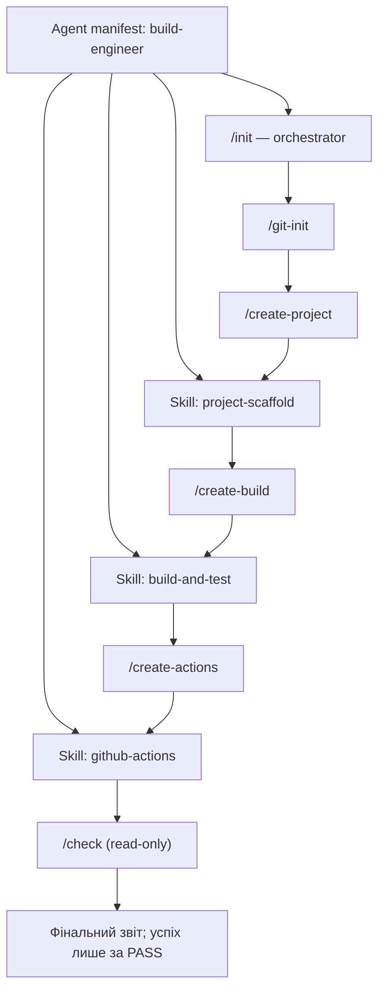

# Архітектура AI-агента Build Engineer

## 1. Які проблеми вирішує агент

Агент Build Engineer автоматизує підготовку невеликого кросплатформного TypeScript Hello World-проєкту та його перевірок:

- створення структури вихідного коду й початкової документації;
- налаштування npm scripts, компіляції TypeScript і Vitest-тесту `BasicAddition`;
- створення launcher-ів та однакових локальних CI-процедур для Unix-подібних систем і Windows;
- підготовка GitHub Actions workflow для Linux, Windows і macOS;
- перевірка очікуваних файлів, тестів, збірки й CI перед оголошенням завершення.

У гілці `develop` зберігається AI-конфігурація та документація; створення прикладного проєкту виконується відповідними prompts після запуску `/init`.

## 2. Взаємодія manifest → skills → commands → orchestrator

| Елемент | Викликає або використовує | Призначення |
|---|---|---|
| Agent manifest `build-engineer.agent.md` | Skills і prompts/commands | Задає роль, область відповідальності, обмеження, критерії успіху й доступні робочі кроки. |
| Skills | Використовуються відповідними commands | Надають спеціалізовані процедури scaffold, build/test і GitHub Actions. |
| Commands/prompts | Застосовують skills, де це потрібно | Виконують окрему задачу: Git-перевірку, scaffold, build/test, CI або read-only перевірку. |
| Orchestrator `/init` | Послідовно викликає `/git-init` → `/create-project` → `/create-build` → `/create-actions` → `/check` | Передає результати між етапами, перевіряє їх, зупиняється на помилці та формує підсумковий звіт. |

Спрощений потік:

## 3. Список skills

- `project-scaffold` — створює мінімальні `src/hello.ts`, `src/index.ts`, каталоги `tests/` і `docs/`, початкові `.gitignore` та README.
- `build-and-test` — налаштовує `package.json`, TypeScript і Vitest, `BasicAddition`, launchers, `ci.sh` та `ci.bat`.
- `github-actions` — створює або точково оновлює `.github/workflows/ci.yml` для Ubuntu, Windows і macOS, використовуючи локальні CI-скрипти.

Кожен skill міститься у власному `.github/skills/<name>/SKILL.md` і має опис призначення, вхідних даних, виходів, кроків, перевірок, помилок та ідемпотентності.

## 4. Список commands

- `/git-init` — перевіряє, що каталог уже є Git-репозиторієм, готує `.gitignore` і показує Git status та поточну гілку; не запускає `git init` автоматично.
- `/create-project` — застосовує `project-scaffold` для TypeScript із `projectName=hello`.
- `/create-build` — застосовує `build-and-test`, встановлює залежності та запускає build і тести.
- `/create-actions` — застосовує `github-actions` для створення workflow на основі наявних `ci.sh` і `ci.bat`.
- `/check` — read-only перевіряє AI-конфігурацію, проєкт, build/test, workflow, Git tracking і секретоподібні рядки; виводить `PASS`, `FAIL` або дозволений `SKIPPED`.
- `/init` — оркеструє всі п'ять команд у визначеному порядку та формує фінальний звіт.

## 5. Дані, що передаються між етапами init

| Етап | Створені або підготовлені дані | Передумова наступного етапу |
|---|---|---|
| `/git-init` | Підтвердження Git-репозиторію, `.gitignore`, Git status і назва гілки. | `git check-ignore build node_modules` підтверджує обидва каталоги. |
| `/create-project` | `src/hello.ts`, `src/index.ts`, README, `tests/`, `docs/`. | Вихідні файли та каталоги існують; README містить команду запуску. |
| `/create-build` | `package.json`, `package-lock.json`, конфігурації TypeScript/Vitest, `src/math.ts`, тест, launcher generator, `ci.sh`, `ci.bat` і build launcher-и. | Build і тести проходять, `BasicAddition` зелений, launcher запускає Hello World. |
| `/create-actions` | `.github/workflows/ci.yml`. | Workflow валідний, містить три ОС і викликає платформні CI-скрипти. |
| `/check` | Таблиця результатів усіх перевірок і загальний статус. | Процес можна назвати успішним лише з результатом `PASS`. |

## 6. Обробка помилок оркестратором

`/init` перевіряє результат кожного етапу перед передачею керування далі. Якщо крок або його обов'язкова перевірка завершується помилкою, оркестратор зупиняється: наступні commands не запускаються. У повідомленні зазначаються крок, причина з діагностики та дія для виправлення. Знайдені проблеми не виправляються автоматично способом, що перезаписує або видаляє дані.

Якщо `/check` повертає `FAIL`, оркестратор перераховує невдалі перевірки й не оголошує проєкт завершеним. Якщо `/check` не запускався, результат позначається `NOT RUN` і загальний статус є неповним/невдалим, а не успішним.

На `develop`, якщо проєктні файли ще не створені, `/check` позначає перевірки проєкту 5–8 як `SKIPPED`, а не `FAIL`; перевірки AI-конфігурації виконуються окремо.

## 7. Відповідність файлів ролям

| Файл | Роль |
|---|---|
| `.github/agents/build-engineer.agent.md` | Agent manifest: роль Build Engineer, інструменти, область відповідальності, правила й критерії завершення. |
| `.github/skills/project-scaffold/SKILL.md` | Skill для початкової структури TypeScript-проєкту. |
| `.github/skills/build-and-test/SKILL.md` | Skill для npm, TypeScript build, Vitest і локальних CI-скриптів. |
| `.github/skills/github-actions/SKILL.md` | Skill для GitHub Actions CI. |
| `.github/prompts/git-init.prompt.md` | Prompt перевірки Git-репозиторію та підготовки `.gitignore`. |
| `.github/prompts/create-project.prompt.md` | Prompt створення scaffold. |
| `.github/prompts/create-build.prompt.md` | Prompt налаштування build, тестів і локальних CI-скриптів. |
| `.github/prompts/create-actions.prompt.md` | Prompt створення GitHub Actions workflow. |
| `.github/prompts/check.prompt.md` | Read-only prompt комплексної перевірки. |
| `.github/prompts/init.prompt.md` | Orchestrator, який координує послідовність prompts. |
| `README.md` | Опис лабораторної, вимог і використання агента/результату. |
| `docs/architecture.md` | Опис компонентів, потоку команд, передачі даних і обмежень. |

Використано формат VS Code Copilot customizations: `.github/agents/` для agent manifest, `.github/prompts/` для prompt-команд і `.github/skills/` для skills.

## 8. Обмеження агента

- Агент працює в межах TypeScript Hello World, npm scripts, Vitest і CI для Windows/Linux/macOS.
- Створення scaffold, build і workflow виконується спеціалізованими skills та prompts; `/check` лише читає і перевіряє стан.
- Повторний запуск має бути ідемпотентним: перед створенням перевіряються файли, наявні файли не перезаписуються без аналізу, зміни мають бути точковими, дублікати `.gitignore` не додаються.
- Заборонено видаляти файли, виконувати `git push --force` чи `git reset --hard`, переписувати історію Git, працювати з токенами/паролями/ключами або змінювати branch protection.
- У workflow build/test команди делегуються `ci.sh` і `ci.bat`, а не дублюються inline.
- Успіх не оголошується без перевірок; оркестрація вважається успішною лише за `/check: PASS`.
- `git-init` не виконує `git init` автоматично. Manifest вимагає від `/init` створити або вибрати feature-гілку, але фактичний orchestrator наразі лише перевіряє Git status і назву гілки, а `git-init` не створює feature-гілку. Узгодьте цю розбіжність перед використанням, якщо перехід у feature-гілку є обов'язковою умовою лабораторної.
